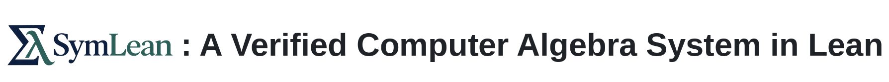
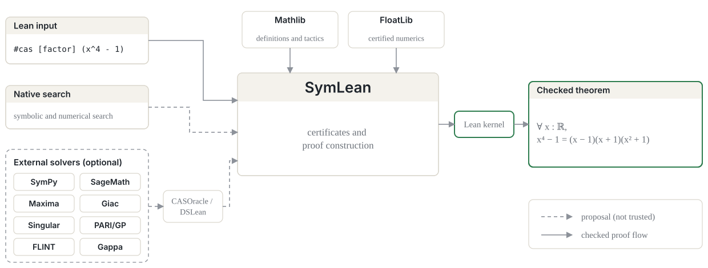

<h1 align="center">
  <picture>
    <source media="(prefers-color-scheme: dark)" srcset=".github/assets/readme-heading-dark.png">
    
  </picture>
</h1>

Computer algebra systems such as Mathematica, Maple and SymPy have long been part of how we do
mathematics. Whether we are deriving an equation, working out an integral or simplifying a
particularly unpleasant expression, it is often much easier to ask a computer to do the calculation.
But when formalizing mathematics in Lean, we still need to prove that the resulting expression is
correct. This can take considerably more effort than finding the answer itself. SymLean grew out of
our interest in making these two processes work together. We wanted something that feels like a
conventional computer algebra system but produces Lean theorems that we can use directly in our
proofs.

The library covers symbolic algebra, differentiation, integration, series expansions, limits,
equation solving, special functions and certified numerical computation. Calculations can be
performed interactively using `#cas` or within an existing Lean proof using the `cas` and `cega`
tactics. An important distinction is that the algorithms used to find an answer do not themselves
need to be trusted. They can be heuristic, and we can even delegate computations to external
computer algebra systems.

<p align="center">
  <picture>
    <source media="(prefers-color-scheme: dark)" srcset="Site/Static/figures/architecture-dark.svg">
    
  </picture>
</p>

Dashed arrows are proposals, which nobody has to trust. SymLean turns them into certificates and
proofs with Mathlib and FloatLib, and Lean's kernel checks the result.

[Documentation](https://lean-dojo.github.io/SymLean/docs/index.html) · [Getting
started](https://lean-dojo.github.io/SymLean/docs/tutorial/first-hour.html) · [Why
SymLean](https://lean-dojo.github.io/SymLean/docs/guide/why.html) · [Trust assumptions](TRUST.md)

## Installation

From a checkout of this repository, fetch the Mathlib cache and build SymLean:

```bash
lake exe cache get
lake build
```

Use the Lean version in [lean-toolchain](lean-toolchain) (`v4.36.0`, with Mathlib `v4.36.0`).
Dependency versions are pinned in [lake-manifest.json](lake-manifest.json).

In your own Lake project, add SymLean with `require`:

```lean4
require SymLean from git "https://github.com/lean-dojo/SymLean.git" @ "main"
```

Then run `lake update SymLean` and `lake exe cache get`, and start a file with `import CAS`. A library
that reads files into proofs with `include_str` or `json_data%` should add SymLean's facet
`SymLean.embeddedInputs` to its `needs`, so that Lake rebuilds a module when such a file changes (see
the [library guide](https://lean-dojo.github.io/SymLean/docs/guide/library.html#certificates)).

## An Example

If you have used Mathematica, Maple or SymPy, `#cas` will feel familiar: you give it a mode and an
expression, and it answers. The difference is that every answer comes back as a theorem that Lean
has checked. Here is a short session, with the answers SymLean prints:

```lean4
import CAS

#cas [factor] (2*x^3 - 3*x^2 + 1)                 -- (x - 1)^2*(2*x + 1)
#cas [derive x] (x ^ 2 * sin x)                   -- x*(2*sin(x) + x*cos(x))
#cas [integrate x] (atan x)                       -- x*atan(x) - 1/2*log(1 + x^2)
#cas [integrate x in [0, 1]] (x * exp x)          -- 1
#cas [limit x → 0] (sin x / x)                    -- 1
#cas [series x 0 7] (sin x)                       -- x - 1/6*x^3 + 1/120*x^5 - 1/5040*x^7 + o(x^7)
#cas [sum k 1 n] (k^2)                            -- n*(n + 1)*(2*n + 1)/6
#cas [solve x] (x ^ 2 = 1)                        -- x = 1 ∨ x = -1
#cas [roots x] (x ^ 5 - x - 1 = 0)                -- 1.16730397826141868425, the only real root
#cas [dsolve y x] (y'' + 3*y' + 2*y = 0)          -- y(x) = c₁*exp(-x) + c₂*exp(-(2*x))
#cas [eigenvalues] !![2, 0, 0; 0, 3, 4; 0, 4, 9]  -- [1, 2, 11]
#cas (zeta 4)                                     -- pi^4/90
#cas [nintegrate x in [0, 1]] (exp (-x^2))        -- 0.746824 ± 10^-6
#cas [simplify] ((x ^ 4 - 1) / (x ^ 2 - 1))       -- x^2 + 1, when x^2 - 1 ≠ 0
```

Each line also prints the theorem behind its answer, with the conditions under which it holds:
the simplification needs $x^2 - 1 \neq 0$, the root is enclosed in an interval of width $10^{-20}$, and the
numerical integral comes with its error bound. Variables need no declaration.

In a proof, the tactics do the same work on your own goals:

```lean4
theorem integral_x_exp : ∫ x in (0 : ℝ)..1, x * Real.exp x = 1 := by
  cas

example (x : ℝ) (hx : x ≠ 0) : x / x = 1 := by
  cas

example (x : ℝ) (h0 : 0 ≤ x) (h1 : x ≤ 1) : x * (1 - x) ≤ 1 / 4 := by
  cega
```

`cas` proves the definite integral in Mathlib's own terms. The second goal needs `hx`, because
division in Lean is total ($1/0 = 0$); without it the tactic fails and names the missing hypothesis
`x ≠ 0`. `cega` proves the bound $x(1 - x) \le 1/4$ on $[0, 1]$. `cas?` and `cega?` suggest a tactic call
to keep.

## What you can work with

Each group below links its guide, and the [documentation](https://lean-dojo.github.io/SymLean/docs/index.html)
lists every mode with examples.

### Algebra and polynomials

- **Simplification and fractions.** `#cas [simplify]` rewrites a real expression and proves that
  the result equals it wherever the printed conditions hold. Cancelling a divisor $d$ adds
  $d \neq 0$, and combining real powers of $a$ adds $a > 0$. In Mathlib $\tan x$ is
  $\sin x / \cos x$, so `#cas [simplify] (tan x * cos x)` gives $\sin x$ under $\cos x \neq 0$.
  `fullSimplify` ranks candidate forms by `leafCount`, `depth` or `length` and keeps the smallest
  one it can prove: `log (x*y) - log x - log y` becomes $0$ under just $x \neq 0$ and $y \neq 0$,
  since Mathlib's logarithm is $\log |x|$. `together` puts a sum over one denominator, `cancel`
  reduces each summand on its own, and `apart` gives partial fractions in one variable, over the
  factors you wrote, refined by gcds. Their theorems assume that the divisors, as written, are
  nonzero. See the [algebra guide](https://lean-dojo.github.io/SymLean/docs/guide/algebra.html).
- **Expanding and factoring.** `expand` multiplies out, `factor` writes a polynomial as a product,
  `collect x` groups the terms by powers of $x$ and `trigExpand` applies the addition and
  double-angle formulas. Each proves an identity for all real values, with no conditions, and the
  tactic `cas` proves the same identities. `factor` finds rational roots, perfect powers and
  homogeneous forms in two variables, and it doesn't claim that a factor left over is irreducible:
  $x^4 + 4$ stays whole, although it factors over $\mathbb{Q}$. With `CASOracle.Factor` imported,
  `#cas [factor, oracle := sympy] (x ^ 4 + 4)` gets $(x^2 - 2x + 2)(x^2 + 2x + 2)$ from SymPy, and
  Lean checks the product, not that the factors are irreducible. See the
  [`factor` page](https://lean-dojo.github.io/SymLean/docs/ref/factor.html).
- **Polynomials in one variable.** `coefficient` and `exponent` read off coefficients and degrees,
  `polynomialQuotientRemainder` divides with remainder, `polynomialGCD` and `polynomialLCM` give
  gcds and lcms, and `interpolatingPolynomial` interpolates. The theorems are about Mathlib's own
  `coeff`, `natDegree`, `/`, `%`, `gcd`, `lcm` and `eval` in `ℚ[X]`, and the tactic `cas` proves
  such goals and refuses a wrong coefficient, degree, gcd or lcm with the right one in its message.
  A gcd comes with its cofactors and a Bézout identity, so the kernel never reruns the Euclidean
  algorithm. Other variables enter `coefficient` and `exponent` as constants in `ℝ[X]`, and
  `exponent` assumes that a leading coefficient involving them is nonzero:
  `#cas [exponent x] (a*x^2 + x + 1)` gives the degree $2$ under $a \neq 0$. See the
  [polynomials guide](https://lean-dojo.github.io/SymLean/docs/guide/polynomials.html).
- **Ideals and Gröbner bases.** `#cas [groebner x, y] [x^2 + y^2 - 5, x*y - 2]` gives the reduced
  lexicographic basis, scaled to integer coefficients, $2x + y^3 - 5y$ and $y^4 - 5y^2 + 4$, which
  ends with a polynomial in $y$ alone. It proves in `MvPolynomial (Fin 2) ℚ` that the basis spans
  the same ideal and, by Buchberger's criterion, that it is a Gröbner basis for
  `MonomialOrder.lex`, but not that it is reduced. The search stops after 400 polynomials or 4000
  pairs. With `CASOracle.Ideal` imported, `oracle := sage`, `singular` or `sympy` proposes the
  basis instead, and Lean checks it the same way. `member` proves `f ∈ Ideal.span {g₁, …, gₘ}`
  with explicit cofactors, and `cas` proves such goals in any commutative ring, though a
  certificate with denominators needs a $\mathbb{Q}$-algebra. A refusal proves nothing about non-membership.
  See the [`groebner` page](https://lean-dojo.github.io/SymLean/docs/ref/groebner.html).

### Equations and linear algebra

- **Equations and inequalities.** `#cas [solve x]` and `#cas [roots x]` give every real solution of
  a polynomial equation with rational coefficients and prove that none is missing. `solve` proves
  `∀ x : ℝ, lhs = rhs ↔ x = r₁ ∨ … ∨ x = rₖ`. `roots` prints the irrational solutions to 20
  decimals, or up to 60 with `(digits := d)`, each in an interval proved to hold exactly one, and
  `roots z in ℂ` lists every complex solution. `#cas [reduce x]` proves exactly where a polynomial
  inequality holds, as a union of intervals. `#cas [solve x, y]` takes linear systems and polynomial
  systems with finitely many complex solutions. Other equations get one simple root at a time:
  `#cas [findRoot x in [0, 1]] (cos x = x)` proves that exactly one solution lies within $10^{-10}$
  of 0.7390851332. In a proof, `cas` proves the `solve` equivalence, bounds on a root and counts of
  real roots. See the [guide](https://lean-dojo.github.io/SymLean/docs/guide/equations.html).
- **Linear algebra.** You write a matrix with rational entries in Mathlib's notation, such as
  `!![1, 2; 3, 4]`, and each answer is a theorem about Mathlib's own definitions. `#cas [det]`
  proves `A.det = d`, `inverse` proves `A⁻¹ = B`, `matrixRank` proves `A.rank = r`, and `rowReduce`
  proves `E * A = R ∧ E.det ≠ 0 ∧ R.IsReducedRowEchelon`. `linearSolve` and `nullSpace` describe
  every rational solution: `#cas [linearSolve] (!![1, 2, 3; 2, 4, 6], ![1, 2])` prints
  `![1, 0, 0] + span of [![-2, 1, 0], ![-3, 0, 1]]` and proves that there are no others. For a
  singular matrix, whose Mathlib inverse is the zero matrix, `inverse` proves `A.det = 0` instead.
  `dot`, `matrixPower`, `transpose` and `trace` give products, powers, transposes and traces, proved
  by kernel evaluation. A determinant with variables, such as Vandermonde's, goes in as a goal for
  `cas`. See the [guide](https://lean-dojo.github.io/SymLean/docs/guide/linear-algebra.html).
- **Eigenvalues and positive definiteness.** `#cas [eigenvalues]` gives the exact eigenvalues with
  their multiplicities and proves that there are no others. For `!![0, 1; 1, 1]` it prints
  `[1/2 - √5/2, 1/2 + √5/2]`, with a theorem about Mathlib's `spectrum ℝ`. Eigenvalues of degree
  three or more, such as the roots of $x^3 - 2$, are named by intervals. `characteristicPolynomial`
  proves `A.charpoly = p`, and `eigenvectors` proves a basis of every eigenspace, irrational
  eigenvalues included. `positiveDefinite` proves `Matrix.PosDef` from an exact $L D L^T$
  factorization with positive pivots, or its negation from a rational $x \ne 0$ with $x^T A x \le 0$
  or an entry that breaks the symmetry. For a symmetric matrix, `eigenvalueBounds` proves sharp
  decimal bounds $c|x|^2 \le x^T A x \le \mu|x|^2$ for every $x$, to 6 places or `(digits := d)`.
  See the [guide](https://lean-dojo.github.io/SymLean/docs/guide/linear-algebra.html#eigenvalues).

### Calculus

- **Derivatives and extrema.** `#cas [derive x] e` prints the derivative and proves a theorem about
  Mathlib's `HasDerivAt`, with each condition it needs as a hypothesis, such as $2x + 2 > 0$ for
  `sqrt (2 * x + 2)`. `#cas [grad x, y] e` proves a `HasGradientAt` theorem and each partial
  derivative on its own. In a proof, `cas` proves `deriv`, `HasDerivAt`, `iteratedDeriv` and
  regularity goals such as `ContDiff` and `AnalyticAt`, and a `HasDerivAt` theorem tagged
  `@[cas_deriv]` teaches it the derivative of your own function. `#cas [minimize x] p` gives the
  minimum of a polynomial in one variable, and `#cas [minimize x in [a, b]] p` its minimum on an
  interval, with a theorem that no value is smaller. `maximize` does the same for the maximum. The
  extremum is exact when a rational point attains it, and otherwise the theorem encloses its value.
  See the [calculus guide](https://lean-dojo.github.io/SymLean/docs/guide/calculus.html).
- **Integrals.** `#cas [integrate x] e` finds an antiderivative `F`, checks it by differentiation,
  and proves `∫ x in a..b, e = F b - F a` for Mathlib's interval integral on every interval where
  the printed conditions hold. For `1 / (x * log x)` the answer is $\log(\log x)$, under $x \neq 0$
  and $\log x \neq 0$. `integrate` covers substitution, rational functions, integration by parts,
  polynomials times exponentials, sines and cosines, rational functions of $\sin x$ and $\cos x$,
  and Gaussians, which give SymLean's `CAS.erf`. It does not factor a general denominator, so
  `1 / (x ^ 3 - 1)` is refused. In `#cas [integrate x in [a, b]] e` an end may be `∞` or `-∞`, and
  the theorem then states integrability too. In a proof, `cas` proves definite and improper
  integrals, and `cas [integrate primitive := F]` checks a primitive you already have. See the
  [integrate page](https://lean-dojo.github.io/SymLean/docs/ref/integrate.html).
- **Series and limits.** `#cas [series x a n] e` gives the Taylor polynomial of degree `n` at a
  rational point `a`, with a theorem that the remainder is little-o of $(x - a)^n$ in Mathlib's
  `=o[𝓝 a]`. The coefficients are exact, so each function must sit where its value is rational,
  such as `log` at $1$, and the order is at most 12. A quotient with a pole at `a` gets a Laurent
  series: `#cas [series x 0 3] (1 / sin x)` gives $1/x + x/6 + 7x^3/360 + o(x^3)$.
  `#cas [limit x → a] e` proves a `Filter.Tendsto` theorem at a rational point, also `from above`
  or `from below`, and at `∞` and `-∞`. A vanishing denominator is handled as with l'Hôpital's
  rule, and `#cas [limit x → ∞] (sqrt (x^2 + 3 * x) - x)` gives $3/2$ by comparing growth rates.
  `cas` proves these limits but not the little-o statements, which you take as hypotheses. See the
  [series and limits guide](https://lean-dojo.github.io/SymLean/docs/guide/series-limits.html).

### Sums, recurrences and number theory

- **Sums and products.** `#cas [sum k a n]` gives the closed form of `∑ k ∈ Finset.Icc a n` and
  proves it for every $n \ge a - 1$ by induction. It takes polynomials, geometric terms and their
  products, and, by Gosper's algorithm, terms $c^k R(k)$ with a rational function $R$ and $c > 0$:
  `#cas [sum k 1 n] (1 / (k * (k + 1)))` gives $n/(n + 1)$, and $\sum 1/k$ has no such closed form.
  `#cas [product k a n]` does the same for a constant times powers of linear factors $k + s$ with
  integer $s$, and in a proof `cas` proves both kinds of closed form when $a$ is 0 or 1. A numeral
  upper bound gives the exact value of a sum. `#cas [sum k a ∞]` sums series of polynomials times
  $r^k$ with $|r| < 1$, and of $c/k^{2m}$, with a `HasSum` theorem that also says that the series
  converges: `#cas [sum k 1 ∞] (1/k^2)` gives $\pi^2/6$. A summand with a parameter is refused. See
  the [guide](https://lean-dojo.github.io/SymLean/docs/guide/sums.html).
- **Linear recurrences.** `#cas [rsolve a n]` gives the general solution of a linear recurrence with
  constant rational coefficients and proves that every solution has this form. When the right side
  has terms $c n^j r^n$, we find a particular solution by undetermined coefficients. With initial
  values you get the only solution with those values. For
  `#cas [rsolve a n, a 0 = 0, a 1 = 1] (a (n + 2) = a (n + 1) + a n)`, the theorem says that a
  sequence `a : ℕ → ℝ` has this recurrence and these values exactly when it is Binet's formula.
  Rational roots and the roots from the quadratic formula are exact, and the other characteristic
  roots, such as the plastic number of the Padovan numbers, are kernel-checked enclosures. In a
  proof, `cas` does not prove these statements, but the closed form follows from the recurrence by
  induction. See [`rsolve`](https://lean-dojo.github.io/SymLean/docs/ref/rsolve.html).
- **Number theory.** You can work with divisors, divisor sums and Euler's totient, modular powers
  and inverses, Bézout coefficients, simultaneous congruences, Jacobi symbols, digits in any base,
  continued fractions, binomial coefficients, factorials and Fibonacci numbers. Each answer is a
  theorem about Mathlib's definitions, such as `Nat.divisors`, `Nat.ModEq`, `ZMod` or `Nat.digits`.
  `#cas [chineseRemainder] ([2, 3, 2], [3, 5, 7])` proves that the solutions are exactly the numbers
  $23 + 105k$, and the moduli need not be coprime. When two congruences contradict each other, or a
  number has no inverse, the theorem says so. In a proof, `cas` proves equations like
  `Nat.totient 36 = 12`. `powerMod` uses repeated squaring, so its proof grows with the number of
  digits of the exponent. `#cas` does not compute prime factorizations or test primality. See the
  [guide](https://lean-dojo.github.io/SymLean/docs/guide/number-theory.html).

### Differential equations and special functions

- **Differential equations.** `#cas [dsolve y x]` solves a linear equation and proves that the
  printed family is exactly the set of solutions. With initial values,
  `#cas [dsolve y x, y 0 = 1, y' 0 = 0] (y'' + y = 0)` proves that $\cos x$ is the only solution.
  Any order works with rational constant coefficients, and in first order, `y' + p * y = q`, `p` and
  `q` may also depend on $x$ or on parameters. A condition the family needs, such as $k + 2 \neq 0$
  for `y' + k * y = exp (2 * x)`, is a hypothesis of the theorem. Without a closed form,
  `#cas [ndsolve y t in [t₀, T], y t₀ = y₀] (y' = f)` proves that the solution exists and is unique
  on $[t_0, T]$ and encloses it at $T$, or at the times in `at [τ₁, …]`. With `(digits := d)` each
  enclosure has width at most $10^{-d}$. `f` is a polynomial of degree at most 4 in `t` and in `y`.
  See the [guide](https://lean-dojo.github.io/SymLean/docs/guide/differential-equations.html).
- **Transforms and Fourier series.** `#cas [laplace t s]` transforms sums of polynomial,
  exponential, trigonometric and hyperbolic terms and proves, for every $s$ above a printed bound,
  that Mathlib's integral of $e^{-st} f(t)$ over $t > 0$ converges and equals the printed rational
  function. `#cas [inverseLaplace s t] (1 / (s ^ 2 + 4))` gives $\tfrac{1}{2} \sin 2t$ and proves
  that its transform is $1/(s^2 + 4)$ for $s > 0$. Mathlib has no uniqueness theorem for the Laplace
  transform, so the theorem does not say this inverse is the only one. `fourierTransform` takes
  Gaussians, in Mathlib's convention. `fourier`, `fourierSin` and `fourierCos` give the coefficients
  of Fourier series on $[-\pi, \pi]$ and of sine and cosine series on $[0, L]$ as exact functions of
  $n$, proved for every $n \ge 1$. In a proof, `cas` proves the integral behind one coefficient. See
  the [guide](https://lean-dojo.github.io/SymLean/docs/guide/differential-equations.html).
- **Special functions.** The exact values of `gamma`, `zeta` and `BernoulliB` come with theorems
  about Mathlib's `Real.Gamma`, `riemannZeta` and `bernoulli`. `#cas (gamma (5/2))` proves
  `Real.Gamma (5 / 2) = 3 * √Real.pi / 4`, and so does `cas` in a proof. `zeta` takes even positive
  integers and nonpositive ones, and `BernoulliB` gives Bernoulli numbers and polynomials with
  Mathlib's $B_1 = -\tfrac{1}{2}$. Orthogonal polynomials print in monomials: `ChebyshevT 5 x` gives
  $16x^5 - 20x^3 + 5x$, proved for Mathlib's polynomial in every commutative ring, and `HermiteH`
  and `HermiteHe` are the physicists' and the probabilists' Hermite polynomials. `erf` and `BesselJ`
  give only enclosures, of width at most $10^{-d}$ with `[N d]`. The Mathlib we build on has no
  error function, so `erf` is our own `CAS.erf`, defined by the Gaussian integral. See the
  [guide](https://lean-dojo.github.io/SymLean/docs/guide/special-functions.html).

### Certified numerics

- **Digits and enclosures.** `#cas [N d] e` gives the first `d` significant digits of a closed
  real expression, with a theorem that every printed digit is right: for $\sqrt 2$ to six digits
  it is $1.41421 \le \sqrt 2 < 1.41422$. `#cas [enclose x in [a, b], y in [c, d]] e` prints an
  interval that holds every value of `e` on the box and proves it, along with an upper bound, a
  bound on the absolute value and a center with a radius. A box has rational endpoints and at most
  8 coordinates by default, and every subexpression has to be defined on all of it. `nintegrate`
  gives an integral to 6 places with a proved error of at most $10^{-6}$, `findRoot` proves that
  an interval of half-width at most $10^{-10}$ around the printed root holds exactly one root, and
  `eigenvalueBounds` proves sharp bounds on the extreme eigenvalues of a symmetric rational
  matrix. See the [numerics guide](https://lean-dojo.github.io/SymLean/docs/guide/numerics.html).
- **The `cega` tactic.** In a proof, `cega` proves numerical bounds with a certificate that the
  kernel checks: `Real.sin x ≤ 0.85` from `0 ≤ x` and `x ≤ 1`, `Real.exp 1 ≤ 2.72`, or
  `(∫ x in (0 : ℝ)..1, Real.exp (-x ^ 2)) ≤ 3 / 4`, whose integrand has no elementary
  antiderivative. A goal can be a one-sided, two-sided or absolute bound, `f ∈ Set.Icc a b`,
  `f ≤ g` or a conjunction of these, and hypotheses such as `a ≤ x` and `x ≤ b`,
  `x ∈ Set.Icc a b` or `|x| ≤ r`, with rational endpoints, give the box. It also proves
  `EnclosedOn f s lo hi`, which says $\mathrm{lo} \le f(x) \le \mathrm{hi}$ for every $x \in s$, and
  the similar `BoundOn`, `ApproxOn` and `ResidualBound`, and `cega using c` reuses such a
  certificate on a smaller domain or with wider bounds without evaluating the function again. A real
  inequality that the box route misses goes to FloatLib's `interval`, which also handles finite
  sums, and trigonometric polynomials in one variable with no bounds on the variable.
  `(depth := n)`, `(prec := n)` and `(panels := n)` tune one call. See the
  [`cega` reference](https://lean-dojo.github.io/SymLean/docs/ref/cega.html).
- **Exact rationals or IEEE floats.** `cega` computes its enclosures with exact rationals unless
  you ask for IEEE floats: `cega [use_floats]` for binary64, `cega (arith := binary128)` for
  another format, or one `weak.cega.arithmetic` line in your lakefile for a whole build. At each
  operation FloatLib computes a rational enclosure in the kernel and rounds its ends outward into
  the format. The theorem doesn't change: it is still about real numbers, with the same three
  axioms. A float call that can't prove its goal fails, names the format and the reason, and never
  computes with rationals in its place. With floats on, `cega` computes no integrals. Exact
  rationals take less kernel time in our measurements, so floats aren't for speed: they give you
  the computation in an IEEE format, with certified ends of a fixed size. See
  [Certificates](https://lean-dojo.github.io/SymLean/docs/guide/certificates.html#arithmetic).
- **Certificates of any size.** `CAS.Cert`, for tables and meshes, isn't part of `import CAS`. You
  write a condition once, in a small language, `Cond`: comparisons, `and`, `or`, a loop `all n` and
  `onIcc` for every point of a cell. Its test runs on balls, and by `Cond.holds_of_check` a pass
  proves the condition for all real data in the balls. `cert_cond` writes the condition for a goal
  without data, such as $e^{xy} + x^2 \le 4$ on $[0, 1]^2$. The size of the data changes only who
  runs the test: the kernel, in one module or in many (`cert_shard`, `cert_aggregate`), compiled
  code under `cega.nativeCertificates`, which also trusts Lean's compiler, or a program that reads
  files, whose run `Run.Ok m family` is a hypothesis. Data too big to state enter the theorem as
  `Nonempty T` for a certificate type `T`, which a verified checker supplies from any input it
  accepts. See the [guide](https://lean-dojo.github.io/SymLean/docs/guide/certificates.html#large).

### In a proof

- **The `cas` tactic.** State the goal in Mathlib's terms and write `cas`. It proves identities,
  derivatives and regularity (`HasDerivAt`, `iteratedDeriv`, `ContDiff`, `AnalyticAt`), interval
  and improper integrals, and limits written with Mathlib's filters. It also proves closed forms
  of finite sums, ideal membership, determinants of matrix literals, the sign of a polynomial,
  counts of real roots and bounds on a box. Every route ends in a proof that Lean checks against
  your goal. A condition such as `x ≠ 0` comes from a hypothesis or from `cas using h`, and a
  missing one is reported, never added. `cas using [h₁, h₂]` adds facts, and `cas [l₁, l₂]` passes
  lemmas or definitions to unfold. `cas [integrate primitive := F]` checks a primitive you supply,
  `@[cas_deriv]` teaches `cas` a derivative, and `cas_nf` normalizes a goal or a hypothesis. See
  the [tactics guide](https://lean-dojo.github.io/SymLean/docs/guide/tactics.html).
- **Keeping the call that worked.** While a proof takes shape, write `cas?` or `cega?`. Each proves
  the goal as `cas` or `cega` would, runs the call it suggests on the original goal before showing
  it, and names the route. The suggestion can be another tactic: after the box route, `cas?`
  proposes `cega`. For `x * (1 - x) ≤ 1 / 4` on `[0, 1]`, `cega?` suggests
  `cega [enclose x in [0, 1]] (x * (1 - x))`, so the proof shows what was enclosed and where. If
  you start from a calculation, `set_option cas.suggest true` turns a `#cas` report into an
  `example` to paste in place of the command. For `#cas [derive x] (tan x)` it is a `HasDerivAt`
  statement with the hypothesis `Real.cos x ≠ 0`, proved by `cas`. Lean checks it where the
  command is, so a copy in another file can elaborate differently. See the
  [`cas?` reference](https://lean-dojo.github.io/SymLean/docs/ref/cas-query.html).
- **When a call refuses.** A call that fails leaves the goal as it was, and its message names what
  was missing and, where there is one, the call or setting to try. A false or too tight bound on a
  box is refused with the value that the query certified and, in case the bound is true, a call
  such as `cega (depth := 4)`. We'd rather have a call stop than hang, so calls run within
  budgets, and the message names the budget a call hit, such as `cas.grindHeartbeats` or
  `cega.maxDimension`. Trace classes such as `trace.cas.fallback` and `trace.cega.stated` show the
  steps of a route. The [options page](https://lean-dojo.github.io/SymLean/docs/ref/options.html)
  lists the budgets with their defaults.

### Other systems and your own extensions

- **Other computer algebra systems.** The optional library `CASOracle`, built on
  [DSLean](https://github.com/taterowney/DSLean), lets SymPy, SageMath, Maxima, Giac, Singular,
  PARI/GP, FLINT and Gappa propose answers, and SymLean proves each one or refuses it. You name the
  system in the mode, so `#cas [factor, oracle := sympy] (x ^ 4 + 4)` asks SymPy and proves
  $x^4 + 4 = (x^2 - 2x + 2)(x^2 + 2x + 2)$ for every real $x$. SymPy, SageMath and Giac propose
  antiderivatives, solutions of equations and differential equations, and closed forms of sums,
  which SymLean checks by differentiating, by substitution and by induction. SymPy and SageMath
  also propose factorizations, Gröbner bases and decimal integrals and eigenvalues, and SymPy
  decimal roots and sums of squares. Maxima proposes antiderivatives and factorizations, Singular
  factorizations and Gröbner bases, PARI/GP and FLINT factorizations (PARI/GP's in one variable)
  and decimal roots of polynomials, integrals and eigenvalues, and Gappa bounds on a box, which
  `cega` proves again. What we can't check, such as whether the factors are irreducible or a list
  of solutions is complete, is a hint outside the theorem, and a missing program or a run past
  `cas.oracle.timeout` (two minutes by default) is a refusal with the reason. The oracle tests run
  with the real programs and with programs that answer wrongly, which SymLean refuses. Build the
  library with `lake -R -Koracle=on build CASOracle`; its files aren't modules, like DSLean's, so a
  `module` can't import it. The [oracle page](https://lean-dojo.github.io/SymLean/docs/ref/oracle.html)
  has the setup and the versions that passed.
- **Oracles in proofs.** `cas [oracle := sympy]` proves a definite integral, an equation that
  follows from the hypotheses, a membership in an ideal or an inequality between polynomials, and
  suggests a proof to keep that doesn't need SymPy. For an equation the suggestion is a
  `linear_combination`, which Mathlib's `polyrith` found until its Sage server was shut down. From
  `h1 : x * y = 1` and `h2 : x = y`, the tactic proves `x ^ 2 = 1` and suggests
  `linear_combination h1 + x * h2`. SageMath and Singular find these too. For an integral the
  suggestion is `cas [integrate primitive := F]`, with an antiderivative from SymPy, SageMath,
  Maxima or Giac. For an inequality it is a script that checks a sum of squares with `ring` and
  `positivity`. A membership, and an inequality whose printed script doesn't check, keep the call.
  See the [oracle guide](https://lean-dojo.github.io/SymLean/docs/guide/oracles.html).
- **SymLean as a library.** `import CAS` brings in the calculator and the tactics, and a file can
  import less, such as `CAS.ExactTactic` for derivatives with `cas`. The certificates under the
  tactics conclude ordinary propositions, such as `EnclosedOn f s lo hi`, so you use what they prove
  like any other theorem. A library that lists the facet `SymLean.embeddedInputs` in its `needs` has
  every file it reads with `include_str` tracked, so editing a table rebuilds its modules. See the
  [library guide](https://lean-dojo.github.io/SymLean/docs/guide/library.html).
- **Extending the tactics.** You extend the tactics through registries, and an entry adds no
  assumption, since a registry only chooses which theorem to apply. `@[cas_deriv]` adds a
  `HasDerivAt` theorem to the derivative route of `cas`, so `cas` differentiates your own functions,
  with the theorem's premises proved at each use. `@[cas_route name]` adds a route of `cas` and
  `cas?`, with an optional priority and goal filter, or a backend of the `#cas` mode `name`.
  `CAS.ExactTactic.routeOrder` lists the routes in the order `cas` tries them.
  `@[cega_carrier route projection]` registers a type of attempts that plain `cega` then tries, and
  a package with its own Euclidean derivative operators registers a backend with
  `@[cas_derivative_backend]`. See the
  [library guide](https://lean-dojo.github.io/SymLean/docs/guide/library.html#extending).

## Why a verified computer algebra system

Computer algebra systems sometimes give wrong answers, usually because an answer only holds under a
condition they don't print. Richard Fateman's review of Mathematica ([J. Symbolic Computation 13(5),
1992](https://doi.org/10.1016/S0747-7171%2810%2980011-2)) reports that `Integrate[1/x^2, {x, -1, 1}]`
gave $-2$, which is what $-1/x$ gives at the endpoints, across the pole at $0$. The integral diverges.
SymPy 1.14.0 gives $-1$ for `integrate(sqrt(2 - x)*sqrt(1/(2 - x)), (x, 0, 1))`, although the integrand
is $1$ on $[0, 1]$ ([sympy#29792](https://github.com/sympy/sympy/issues/29792)). In Sage 10.2 to 10.9 the
reduced echelon form of some sparse rational matrices was wrong
([sagemath/sage#42411](https://github.com/sagemath/sage/issues/42411), fixed in Sage 10.10).

SymLean gives none of these wrong answers. On Fateman's integral our own search proposes $-2$ as well,
but the proof then needs $x \neq 0$ on all of $[-1, 1]$, so `#cas [integrate x in [-1, 1]] (1 / x ^ 2)`
refuses:

```text
error: `cas` did not prove the value -2 of the integral: it could not prove that the conditions of the primitive -(1/x) hold on the interval (x ≠ 0). The endpoint calculation needs a primitive valid throughout the interval.
```

On SymPy's integrand our search finds no antiderivative and says so. For the matrix from Sage's
report, SymLean returns row operations E with a theorem that E A = R, with E invertible and R in
reduced echelon form, which determines R. [Why
SymLean](https://lean-dojo.github.io/SymLean/docs/guide/why.html) has more cases.

## Trust assumptions

A theorem from SymLean relies on:

- its statement: the one you wrote, or the one the `#cas` report prints;
- the Mathlib definitions it mentions, such as `Real.arctan`, and in a few answers SymLean's own short
  definitions, such as `CAS.erf`;
- Lean's kernel, with the three standard axioms `propext`, `Classical.choice` and `Quot.sound`.

A report prints its statement through Lean's pretty printer, which writes a cast as `↑n` without its
target type, so two different statements can look the same. When that matters, write the statement
as an `example` in your own file and prove it there; `set_option cas.suggest true` offers that
`example`, ready to paste.

One option, off by default, trusts more: with `cega.nativeCertificates`, `cega [fast]` and the
certificate commands check large finite certificates with compiled code, and `#print axioms` then
shows the native axioms involved. [TRUST.md](TRUST.md) lists everything a proof trusts with the reason
for each item, and the [trust tutorial](https://lean-dojo.github.io/SymLean/docs/tutorial/trust.html)
goes through both profiles.

## Limitations

- A refusal proves nothing. A search can miss an answer that exists, and SymLean does not compute
  everything Mathematica can.
- An answer is correct, but complete only when the theorem says so, as with `roots`. `findRoot`
  proves one root and its uniqueness near the printed value.
- A certified bound on a residual is not a bound on an error. It becomes one only through a stability
  theorem that your own proof supplies.
- SymLean is slower than Mathematica or SymPy, because every answer pays for a proof. Finite tables
  are where the kernel is slowest; the [certificate
  guide](https://lean-dojo.github.io/SymLean/docs/guide/certificates.html#large) explains how to split
  the work across modules or opt into compiled evaluation.

## Contributing

Follow Mathlib's conventions and keep every proof complete. `lake exe cache get` and then
`lake build` check every proof, the examples included, with warnings as errors. The [library
guide](https://lean-dojo.github.io/SymLean/docs/guide/library.html#checking) lists the test scripts,
`scripts/dups.sh` and the site build to run on a change.

## Related work

Letting an untrusted search propose and the prover check is an old idea: Harrison and Théry combined
HOL with Maple this way ([J. Automated Reasoning 21,
1998](https://doi.org/10.1023/A:1006023127567)). The closest project in Lean is [Hex](https://github.com/leanprover/hex), the Lean FRO's verified
computational algebra, which proves factorization, determinants and primality in Lean. On Lean 4.35
SymLean called it for Berlekamp–Zassenhaus factoring, Bareiss determinants and primality
certificates, and that route comes back as soon as Hex is released for Lean 4.36; we are in touch
with its developers. [Why
SymLean](https://lean-dojo.github.io/SymLean/docs/guide/why.html#precedent) cites the work in HOL
Light, Isabelle, Coq and Rocq, and Lean that SymLean builds on.

## Credits

SymLean is built at Caltech by Robert Joseph George, Changhe Yang, Peicong Song, Thomas Y. Hou and
Anima Anandkumar. It is built on Mathlib (The mathlib Community, "The Lean Mathematical Library",
CPP 2020, <https://doi.org/10.1145/3372885.3373824>). The certified numerics use
[FloatLib](https://github.com/lean-dojo/FloatLib) by Robert Joseph George, Will Adkisson and Anima
Anandkumar. DSLean is by taterowney and the DSLean contributors, under [CC BY 4.0](https://creativecommons.org/licenses/by/4.0/).

## License

SymLean is released under the Apache License 2.0; see [LICENSE](LICENSE).
